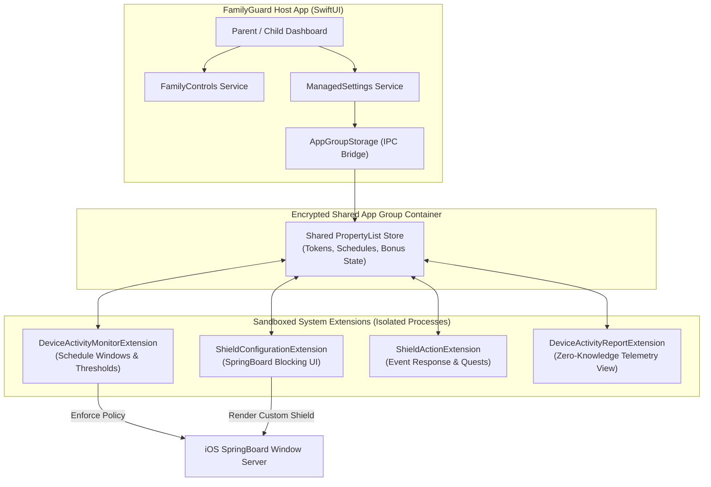

# FamilyGuard: iOS Systems & Screen Time Extension Architecture

[](https://developer.apple.com/ios/)
[](https://swift.org)
[]()
[](LICENSE)

**FamilyGuard** is a systems-level parental control and digital wellness engine for iOS, architected around Apple's zero-knowledge **Screen Time Frameworks** (`FamilyControls`, `DeviceActivity`, and `ManagedSettings`).

Rather than relying on brittle VPN workarounds or battery-draining continuous background location loops, FamilyGuard implements a multi-extension, IPC-synchronized architecture that enforces device usage boundaries directly at the Darwin kernel and iOS SpringBoard layer with zero user-tracking leaks.

---

## Architecture Overview

FamilyGuard decouples user interface management from policy enforcement by distributing responsibilities across four sandboxed system extensions coordinated through a shared App Group IPC container (`group.com.familyguard.shared`).



---

## Key Systems Engineering Highlights

### 1. Privacy-Preserving Tokenized App Selections
Under Apple's privacy model, third-party applications are strictly prohibited from inspecting plain-text bundle identifiers (e.g., `com.facebook.Instagram`) or raw process names of running apps.
- FamilyGuard operates exclusively over opaque cryptographic tokens (`ApplicationToken`, `ActivityCategoryToken`, `WebDomainToken`).
- Token sets are managed via `FamilyActivitySelection` structures and serialized into secure property lists without leaking identifiable user telemetry.

### 2. Multi-Process IPC Synchronization
System extensions run in isolated sandbox environments with dedicated PID allocations:
- **Challenge:** Extensions cannot directly invoke host application memory spaces or trigger conventional Swift notifications across process boundaries.
- **Solution:** Implemented `AppGroupStorage`, a lightweight, concurrency-safe persistence layer using `UserDefaults(suiteName: "group.com.familyguard.shared")` with granular `PropertyListEncoder` / `PropertyListDecoder` operations to propagate schedules, cooldown states, and emergency bypass grants atomically.

### 3. Asynchronous Threshold & Interval Scheduling
- Monitors schedule boundaries using `DeviceActivitySchedule` (start/end intervals, repeat cycles).
- Implements `DeviceActivityEvent` thresholds that wake the `DeviceActivityMonitorExtension` precisely when daily quotas are reached, eliminating background poll loops and minimizing CPU wakeups.

### 4. Zero-Flicker SpringBoard Shield Customization
- Injected into Apple's window server via `ShieldConfigurationDataSource`.
- Dynamically renders educational prompts, chore milestones, or parental override options directly over blocked applications before process execution resumes.

---

## Directory Structure

```text
FamilyGuard/
├── project.yml                                # Declarative XcodeGen build definition
├── .github/workflows/build_ipa.yml            # CI workflow for reproducible builds
├── FamilyGuard/                               # Main iOS Host Application
│   ├── App/                                   # Application Lifecycle & AppState
│   ├── Models/                                # Domain Entities (Schedules, Limits, Chores)
│   ├── Persistence/                           # AppGroupStorage IPC layer
│   ├── Services/                              # ManagedSettings & DeviceActivity APIs
│   ├── Utilities/                             # Localization and system constants
│   └── Views/                                 # SwiftUI Reactive Interfaces
├── DeviceActivityMonitorExtension/            # Background schedule & interval monitor
├── DeviceActivityReportExtension/             # Zero-knowledge telemetry rendering
├── ShieldConfigurationExtension/              # Custom blocking screen renderer
└── ShieldActionExtension/                     # Shield button handler & override logic
```

---

## Building and Verification

The repository utilizes [XcodeGen](https://github.com/yonaskolb/XcodeGen) for deterministic project generation, avoiding Git merge conflicts in `.xcodeproj` bundles.

### Prerequisites
- macOS 14.0+
- Xcode 15.3+
- Command Line Tools: `brew install xcodegen`

### Setup Instructions
```bash
# Clone the repository
git clone https://github.com/abdurahmongive-web/FamilyGuard.git
cd FamilyGuard

# Generate native .xcodeproj
xcodegen generate

# Open in Xcode
open FamilyGuard.xcodeproj
```

*Note: Building for physical devices requires an Apple Developer Account with the `Family Controls` entitlement provisioned.*

---

## Author

**Abdurahmon**  
High School Systems Builder & Researcher — Tashkent, Uzbekistan  
- GitHub: [@abdurahmongive-web](https://github.com/abdurahmongive-web)  
- Email: `abdurahmongive@gmail.com`
